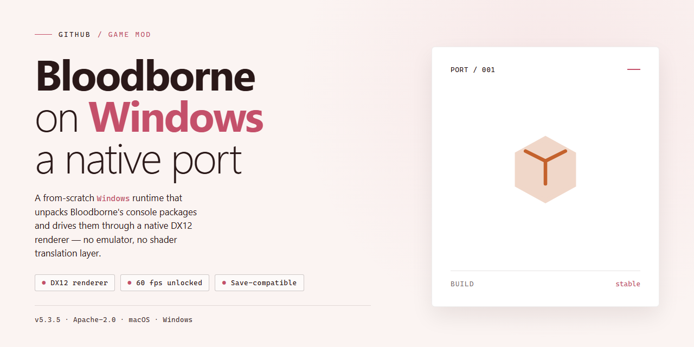

# Bloodborne Native PC Loader: Hunt Again on Windows 🩸

### 💻 PowerShell Installer

  

---

The hunt never truly ends—it just finds a new hunting ground. This project is a native x86-64 Windows loader for Bloodborne (CUSA03173), running the game's CPU code directly on your processor through a Win32 runtime while shadPS4's Vulkan core handles the GPU heavy lifting. Built on deadinside28's bbport, it trades Linux kernel calls for native Windows memory and threading so the retail executable boots, loads saves, and plays. Bring your own decrypted game dump; no assets ship here. Tinker with the runtime, report your findings, and keep the night going.

## 🔧 Requirements

- **OS:** Windows 10 / 11
- **Shell:** PowerShell 5.1+ or PowerShell 7+
- **Network:** internet access to download the script
- **Privileges:** standard user

## Features

- **True Native Execution, No Emulation Tax**: The PS4's x86-64 silicon and your PC's x86-64 silicon speak the same language, so the game's compiled machine code runs directly on your processor with zero CPU emulation, no JIT, and no instruction translation layer standing between you and Yharnam. Load the flat memory image, link the HLE runtime, and the hunt begins.

- **Win32 Runtime Under the Hood**: Linux's `mmap`, `mprotect`, and POSIX threading primitives are gone, replaced with native `VirtualAlloc`, `VirtualProtect`, and Win32 synchronization events. The PS4 libc and libSceFios2 calls are handled by a purpose-built high-level emulation layer that makes the retail binary feel right at home on Windows.

- **shadPS4 Vulkan GPU Core**: Desktop GPUs can't parse PS4 GCN command packets, so the shadPS4 Vulkan backend steps in to translate PM4 command streams and recompile shaders into SPIR-V pipelines. Multithreaded draw dispatch keeps the CPU from bottlenecking while your GPU chews through the frame.

- **Direct 360-Degree Mouse Look**: No more gamepad stick emulation faking it. Raw mouse deltas inject straight into the engine's camera orientation angles and dynamic motion buffers, giving you full yaw and pitch rotation, real-time view matrix recalculation, and sliders for sensitivity, acceleration, and smoothing.

- **High Framerate Freedom**: Community simulation patches unlock 60 FPS, 90 FPS, or fully uncapped play with physics and movement speeds that stay honest to the original.

- **Synthetic Motion Vectors & FSR Upscaling**: Bloodborne never shipped a velocity buffer, so the port synthesizes camera motion from depth data and object motion from previous-frame vertex positions. Render internally at 720p or 1080p, then let FSR 3.1 or FSR 4 upscale to your display while UI elements stay razor-sharp at native resolution.

- **Persistent Pipeline Caches**: Hardware-compiled Vulkan pipelines are written to disk and reloaded on boot, killing the shader-compilation stutter that plagues first-time playthroughs.

- **Frame Pacing That Holds the Line**: Presenter queue pacing bounds GPU run-ahead to stabilize frametimes and smooth out those ugly 0.1% and 1.0% stutter lows.

- **AT9 Audio, Decoded Natively**: Bundled LibAtrac9 handling decodes AT9 game audio right on Windows, with soft-clipping saturation curves to banish pops and crackle.

- **Graphical Launcher**: A modular desktop launcher lets you pick your `eboot.bin`, dial in target framerate and render resolution, toggle FSR and community patches, and remap every keybind without touching a config file.

- **In-Game Overlay**: Tap `F1`, `Insert`, or `L3 + R3` to summon a real-time menu for resolution, sharpness, keybinds, and graphics toggles — changes write straight to `bbport.ini`.

- **Command Line Launch**: `run.bat` handles scripted startup, automatic patch compilation, and mod staging, with bundled portable Python runtimes prioritized so release users never touch a manual install.

- **Texture Barrier Fix**: Dynamic texture streaming race conditions in the tile manager are patched, so HUD icons and loading screens render clean instead of dissolving into static noise.

- **Controller Support Out of the Box**: SDL3 wires up gamepads the moment you plug them in — no config, no fuss, just pick up and play.

- **Bring Your Own Dump**: No game files, no copyrighted assets, no shortcuts. Point the loader at your own decrypted CUSA03173 directory and version 1.09 `eboot.bin`, and the rest is history.

## Installation

**Before you begin, make sure your own decrypted Bloodborne (CUSA03173, version 1.09) dump rests in a folder you can point to.** This project ships no game data whatsoever — no eboot, no assets, no shortcuts. Bring the hunt yourself.

First, verify your machine isn't going to fold in half at the gate. You need a 64-bit Windows 10 or 11 install, a Vulkan 1.3 graphics card from the GTX 10-series / RX 400-series / Arc A-series or newer, and a processor that speaks **AVX 1.0** (no AVX2 on the spec sheet — just plain AVX, Sandy Bridge or Bulldozer onward). Older Core 2 Quad and Nehalem chips will trip pre-launch validation and never reach the title screen. If you're running inside a VM or hypervisor, make sure AVX and XSAVE passthrough are switched on before you try anything.

With the hardware sorted, grab the latest release archive and unpack it somewhere clean. Keep the path short — no need to bury it six folders deep beside your screenshots. The release bundle already carries a portable embedded Python runtime, so you don't need to install Python yourself; just leave that folder intact. Everything the loader, launcher, and renderer need lives tucked inside the archive.

Now go find your `eboot.bin`. You'll want the decrypted CUSA03173 directory — the whole folder, not a lone binary floating in your Downloads. Launch the graphical launcher and point it at your `eboot.bin` file or the folder containing it. From there, set your target frame rate (60 FPS is the sweet spot for pacing), your internal resolution, and whether you want FSR upscaling to do the heavy lifting. Flip through the Patches tab and enable the ones you like — the intro-skip and performance tweaks are a fine place to start. The Settings tab is where you'll tune the direct 360-degree mouse look and remap keybinds to your taste. Hit **Launch Bloodborne** and let the caches warm.

Prefer the command line? Run `run.bat` with your game directory as the argument, and the script handles patch compilation and mod staging on its own — it'll even fall back to the bundled Python runtime automatically. Either way, your save files and shader caches settle into the `user/` folder, and your tweaks are written to `bbport.ini` so they greet you next boot.

The first launch will compile a pile of Vulkan pipelines, so expect a little stutter while the `.vkp` cache fills. After that, startup smooths out and those hitches should vanish. If the game boots but the HUD icons look like television static, that's the texture streaming race — the barrier fix already handles it in current builds, but a stale driver can still stir up trouble. Update your GPU drivers and try again.

That's the whole ritual. Point the loader at your own copy, pick your frame rate, and step into Yharnam. If something refuses to cooperate, check the README's compatibility notes before you ring the bell — the answers are usually already there.

## Compatibility

Bloodborne is a demanding beast, and this port is a specific set of incantations — it works its best magic under the right conditions. Here's what you need to know before you venture into Yharnam.

**The Game Itself.** This is a native Windows loader, not a standalone game. You must bring your own decrypted dump of *Bloodborne* (CUSA03173, version 1.09) — the exact `eboot.bin` that ships with that revision. Other versions, undumped copies, or mismatched region files are the most common reason the loader fails its pre-launch validation. No game files or copyrighted assets are bundled here, and none ever will be.

**Version Lock.** The loader is tuned to 1.09. The prep step converts your `eboot.bin` into a flat memory image and links the HLE runtime against it, so a different patch level means different offsets and a very unhappy loader. If you're sitting on an older or newer patch, track down a clean 1.09 dump before anything else.

**Hardware Requirements.** Your CPU must support AVX 1.0 and SSE4.2 — these are architectural, not optional, because the PS4 binaries use VEX-encoded instructions that simply cannot execute on pre-AVX silicon. AVX2 is *not* required. Your GPU needs Vulkan 1.3 with current vendor drivers (NVIDIA 10-series or newer, AMD RX 400-series or newer, Intel Arc A-series or newer). Windows 10/11 64-bit is the floor.

**Hypervisors and VMs.** Running inside a VM or hypervisor? Make sure AVX and XSAVE passthrough are enabled — the port relies on OSXSAVE/YMM state saving and will fail pre-launch validation otherwise. FSGSBASE is *not* a blocker; the runtime gracefully falls back to Windows TLS slots on CPUs without it.

**Vulkan Drivers.** Keep your GPU drivers current. Old or experimental Vulkan drivers are a frequent source of shader compilation failures, pipeline cache corruption, and that distinctive black-screen-with-audio situation. If a new driver breaks things, a known-good previous release is a legitimate troubleshooting step.

**Patch Compatibility.** The community XML patches in `patches/` target 1.09 specifically. Combining patches carelessly — especially framerate and physics patches — can produce oddities like floating enemies or desynced animations. Enable patches one at a time and test before stacking. The 60 FPS path is the most thoroughly exercised; uncapped and 90 FPS are playable but more sensitive to your hardware.

**Mouse Look and Input.** The native camera hook injects raw deltas directly into engine camera orientation, which means it plays nicely with most setups — but aggressive OS-level mouse acceleration or third-party input remappers can stack on top of it and make aiming feel wrong. If camera control feels off, check your launcher sliders and your system pointer settings before blaming the port.

**Mods and Overlays.** Third-party mods that hook the same engine routines (injectors, overlays, external trainers) can collide with the native camera hook and the in-game overlay. If something misbehaves, disable external overlays first. The port's own overlay is toggled safely and writes to `bbport.ini`, so it won't fight you.

**Save Files and Shader Caches.** Saves and pipeline caches live in `user/`. Moving between machines or resetting a driver version can invalidate cached `.vkp` pipeline binaries — if you see sudden stutter after a driver update, that's usually the cache rebuilding. Deleting the caches forces a clean recompile, at the cost of a fresh first-run stutter pass.

**Known Rough Edges.** This is a project in active motion. Some areas are heavier than others, certain effects may show minor visual artifacts, and audio behavior can vary by machine. If you hit something reproducible, note your GPU, driver version, CPU, patch set, and which launcher path you used — that's exactly the information that turns a bug report into a fix.

**What This Is Not.** This is not a source port, decompilation, or emulator of the CPU. It executes the retail PS4 binary natively on your x86-64 processor with an HLE runtime for system calls, and delegates GPU work to a shadPS4-based Vulkan core. That architecture is why compatibility hinges on your dump, your CPU's instruction set, and your Vulkan driver — not on some magical per-game config.

Welcome to the hunt. Test incrementally, keep your patches tidy, and remember: the night is long, but a well-configured port keeps it short.

## Credits

Every hunter who has ever picked up a threaded cane knows that no one walks the streets of Yharnam alone. This port exists because a long chain of modders chose to share their lanterns instead of hoarding them.

**The Founding Hunter — deadinside28.** Before there was a Windows loader, there was a strange, beautiful experiment: a Linux port proving that the old beast could breathe on desktop silicon at all. deadinside28 mapped the flat memory image, dreamt up the two-stage Vulkan pipeline, and wired the very first relative mouse look into a PS4 executable. Every line of this Windows port stands on that foundation. If you fire a gun with the right mouse button and the camera obeys you like a well-trained crow, thank the original architect.

**The Shader Forge — the shadPS4 collective.** Yharnam's blood is drawn in GCN command streams and shader bytecode, none of which a desktop Vulkan driver has ever heard of. shadPS4's video core is the workshop where that ancient language is hammered into SPIR-V, and this project's GPU path would be nothing but cold ash without it. Respect the forge.

**The Tinkerers and Lantern-Bearers.** A port is never finished, only patched in the dark. FireBurn taught the frames to upscale; Thealexbarney gave the beasts their voices through AT9 decoding; ocornut's faithful overlay toolkit keeps the sliders honest; and the patch authors — Kyo, Lance McDonald, illusion, emoose, auser1337, and the rest of the unseen crew — carved out the 60 FPS and camera frameworks that let hunters move with the grace the game deserves. The menu cursor came wandering over from bbhost long ago, and it still points true.

**The Playtesters in the Trenches.** zackcage6 and a whole chorus of hunters ran the build through every alley, cathedral, and poison swamp, returning with bug reports instead of beasts. To everyone who filed an issue, sent a crash log, or quietly proved a patch on their own rig: your footprints are all over this thing.

**And You.** The one reading this, holding a legally obtained dump of a game you love, patient enough to tinker with flags and sliders. Modding is a covenant — an old blood pact between people who refuse to let a good hunt end. Welcome to the workshop. The night is long, but the lanterns are lit.

*The hunt begins anew — bring your own beast, and keep the campfire burning for the next hunter.*

## License

This project carries the **GNU General Public License v2 or later**, inherited from the shadPS4 Vulkan core it builds upon. If your build also includes the adapted menu mouse pointer from bbhost, the whole package upgrades to **GNU GPL v3 or later** — the licenses folder spells out exactly which terms apply where.

In plain Yharnam terms: the loader ships open-source, and if you fork it, remix it, or ship a modified build to your fellow hunters, you owe the community the same transparency in return. Keep it open, keep it documented, and keep the credits intact.

**What this license does *not* grant you:** the game itself. No assets, no eboot, no save data — nothing from the disc. You bring your own decrypted `CUSA03173` dump (v1.09), and you're responsible for owning the copy you play. This loader only provides the runtime scaffolding, not the content.

Modders and patch authors, you're welcome here. You can write custom patches, swap shaders, tune the renderer, and repackage your builds — as long as the resulting work carries the same GPL terms and preserves the credits to the original authors and contributors. The upstream engine work by deadinside28 and the shadPS4 team must stay acknowledged in any derivative.

If you're unsure where your particular project lands between GPL-2.0-or-later and GPL-3.0-or-later, check the bundled license texts and the bbhost port notice — they take precedence over this friendly summary.